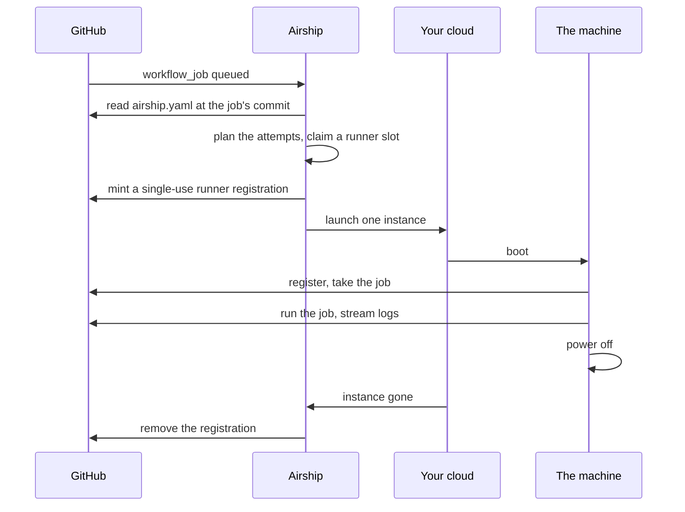

Airship sits between GitHub and your cloud account and does one thing: turns
a queued job into a machine, and a finished job into no machine.

## Step by step

<Steps>
  <Step title="GitHub says a job is queued">
    A `workflow_job` webhook arrives. If none of the job's labels start with
    `airship-`, Airship stops here and the job costs nothing. Jobs on
    `ubuntu-latest` never touch any of this.
  </Step>

  <Step title="Airship reads your config at that commit">
    `airship.yaml` is read from the job's own commit, so a branch can try a
    new machine shape before it is merged. Organization-wide definitions in
    [`.airship`](/organization/runners) are read from that repository's
    default branch.

    If the file does not parse, the job is skipped with a reason naming the
    field, and the error lands on **Events**.
  </Step>

  <Step title="The job is planned once">
    Every matching definition becomes an ordered list of attempts — one per
    combination in its [fallback lists](/configuration/fallbacks), then any
    other definition sharing the label. The plan is fixed now. Editing the
    file afterwards does not change how a waiting job is served.
  </Step>

  <Step title="A runner slot is claimed">
    Under a row lock on your installation, Airship checks the live runner
    count against [`max_runners`](/organization/capacity). Several control
    plane replicas cannot both take the last slot.
  </Step>

  <Step title="GitHub mints a single-use registration">
    A just-in-time runner configuration, good for exactly one registration and
    one job, scoped to that repository. Its GitHub runner ID is stored
    *before* the machine is created, so nothing can boot without a record to
    clean up.

    Registration takes a round trip. If the job was cancelled or picked up
    elsewhere in that window, no machine is created and the registration is
    removed at once.
  </Step>

  <Step title="Your cloud launches one instance">
    Airship opens your sealed credential, makes one API call, and discards
    it. The machine carries tags identifying the installation, repository and
    runner, so you can group a bill by repository with no extra
    instrumentation.

    On first use in a region, Airship also creates the shared pieces it needs
    — an egress-only security group, or a network, or a NAT — and reuses them
    forever after. [What Airship creates in your
    account](/clouds/overview#what-airship-creates).
  </Step>

  <Step title="The machine boots and takes the job">
    A startup script schedules its own shutdown deadline first, then installs
    (or finds) `actions/runner`, registers with the configuration it was
    given, and runs as an ephemeral runner. It exits after one job.

    The runner talks to GitHub directly. Logs, artifacts, secrets and
    checkouts never pass through Airship.
  </Step>

  <Step title="The machine destroys itself">
    Every exit path powers the machine off: the job finishing, the runner
    crashing, the script failing, the deadline expiring. Airship then deletes
    the instance along with the disks, address and interface it created, and
    removes the GitHub registration two minutes later — but only if GitHub
    agrees the runner is not busy.
  </Step>
</Steps>

## One job per machine

This is the property everything else rests on. A runner is registered for a
single job and the machine is destroyed afterwards, so no job can read
another's checkout, caches on disk, environment or in-memory state. There is
no pool of warm machines quietly accumulating state between jobs — even
[idle runners](/performance/idle-runners) are replaced the moment they take a
job.

## When things go wrong

Clouds run out of capacity, webhooks arrive out of order, and control planes
get restarted mid-launch. The design assumes all three.

<AccordionGroup>
  <Accordion title="A launch fails" icon="circle-x">
    The next attempt in the plan is tried. A failure your cloud marks
    retryable — capacity, throttling — starts the list over, until the job has
    had three failed launches or one per attempt, whichever is more. A
    permanent failure such as a missing image stops once every attempt has
    been tried. Every failure is on **Events**, with your cloud's own message.
  </Accordion>

  <Accordion title="The job is cancelled" icon="square">
    While queued, no machine is created and the registration is removed. While
    running, the runner stops, the machine powers off and the instance is
    deleted. Cancelling a job is the cheapest way to confirm this for
    yourself.
  </Accordion>

  <Accordion title="The answer to a launch is lost" icon="unplug">
    The runner is marked `launch_unconfirmed`: the cloud may or may not have
    made a machine. The job is retried, and an inventory scan either finds the
    machine and revives the runner or, after a grace period, writes it off.
    Nothing is left running and nothing is double-charged for long.
  </Accordion>

  <Accordion title="A control plane replica dies mid-launch" icon="server-off">
    Launching runners hold a lease. When it expires another replica takes
    over, reconciling against what the cloud actually has rather than what the
    database last wrote.
  </Accordion>

  <Accordion title="A machine is stopped by hand" icon="power-off">
    It runs no job and still bills for its disk, so it is treated as gone: the
    next inventory pass deletes it and the runner is finished.
  </Accordion>

  <Accordion title="The control plane disappears entirely" icon="cloud-off">
    Every machine schedules its own shutdown before anything else runs, so
    nothing runs forever. You may be left with instances to clean up by tag.
  </Accordion>
</AccordionGroup>

## Runner states

| State | Meaning |
| --- | --- |
| `pending` | Planned, waiting for a slot and a launcher |
| `launching` | A registration exists, the cloud has been asked for a machine |
| `running` | The machine exists; the runner may not have registered yet |
| `busy` | GitHub handed it the job |
| `finished` | Done, with a reason: `completed`, `cancelled`, `idle`, `launch_failed`, `launch_unconfirmed`, `lease_expired`, `lost`, `max_lifetime` or `deleted` |

A launched runner that no job arrives for within ten minutes finishes as
`idle` — almost always a label mismatch. Every machine has a hard lifetime
(eight hours by default) after which it finishes as `max_lifetime`.

<Card title="Reading the trail" icon="list" href="/dashboard" arrow>
  **Jobs** shows what was planned, **Runners** shows what was launched, and
  **Events** shows everything that failed or quietly degraded along the way.
</Card>
