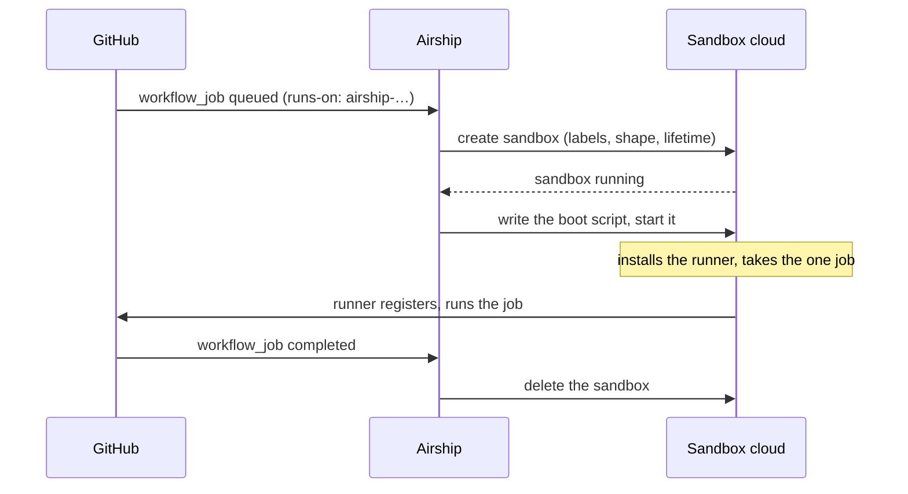

A sandbox cloud runs each job in a container or microVM it manages for you,
started in seconds, billed by the second, with no VPC, image or quota of
yours to set up. Airship treats one like any other cloud: you connect a
credential, name it in `cloud:`, and each job gets a fresh sandbox that is
gone when the job ends.

<Columns cols={2}>
  <Card title="Daytona" icon="/images/clouds/daytona.svg" href="/sandboxes/daytona" arrow>
    Containers from any image or a snapshot, with Docker, volumes, egress
    allow lists and GPUs.
  </Card>
  <Card title="Runloop" icon="/images/clouds/runloop.svg" href="/sandboxes/runloop" arrow>
    Devboxes from blueprints, in named sizes or custom shapes, for up to 48
    hours.
  </Card>
  <Card title="E2B" icon="/images/clouds/e2b.svg" href="/sandboxes/e2b" arrow>
    Firecracker sandboxes from templates, up to 24 hours on the Pro plan.
  </Card>
  <Card title="Novita" icon="/images/clouds/novita.svg" href="/sandboxes/novita" arrow>
    E2B-compatible sandboxes, marked long-running past the plan's session
    cap.
  </Card>
  <Card title="Lelantos" icon="/images/clouds/lelantos.svg" href="/sandboxes/lelantos" arrow>
    E2B-compatible Firecracker sandboxes in the EU.
  </Card>
  <Card title="Namespace" icon="/images/clouds/namespace.svg" href="/sandboxes/namespace" arrow>
    microVMs built for CI, in the US or EU, with the VM's own Docker.
  </Card>
  <Card title="Tenki" icon="/images/clouds/tenki.svg" href="/sandboxes/tenki" arrow>
    Firecracker microVMs from any image, in any shape.
  </Card>
  <Card title="Modal" icon="/images/clouds/modal.svg" href="/sandboxes/modal" arrow>
    Sandboxes with GPUs, from any registry image.
  </Card>
</Columns>

## How a sandbox runner works

Every sandbox carries labels naming your organization and the runner, so
Airship lists only its own sandboxes and refuses to delete anyone else's. A
repeated launch finds the sandbox it already made instead of making a second
one. Each sandbox also has a lifetime set past the runner's deadline, so
nothing outlives its job for long even if Airship is unreachable.

## What each one offers

| | Instance type | Image | Regions | Docker | GPU | Longest sandbox |
| --- | --- | --- | --- | --- | --- | --- |
| [Daytona](/sandboxes/daytona) | Shape (`4vcpu-8gb`) or snapshot | Any image | `us`, `eu`, dedicated | Yes | Yes | Your runner lifetime |
| [Runloop](/sandboxes/runloop) | Size (`large`) or shape | Blueprint | — | Yes | — | 48 hours |
| [E2B](/sandboxes/e2b) | Template | The template | — | Yes | — | 24 hours (1 on Hobby) |
| [Novita](/sandboxes/novita) | Template | The template | — | Yes | — | 24 hours (long-running) |
| [Lelantos](/sandboxes/lelantos) | Template | The template | — | Yes | — | 24 hours |
| [Namespace](/sandboxes/namespace) | Shape | Any image | `us`, `eu` | The VM's own | — | Your workspace's maximum |
| [Tenki](/sandboxes/tenki) | Shape | Any image, or Tenki's | — | Yes | — | Your runner lifetime |
| [Modal](/sandboxes/modal) | Shape | Any image | — | VM runtime | Yes | 24 hours |

Clouds without regions use the one region `global`: leave `region:` out.

## What is the same everywhere

- **Linux, x64.** Windows images, `run_as` and the other Windows settings
  are refused.
- **No `provision_via`.** A sandbox runs nothing of yours at boot; Airship
  starts the runner itself.
- **No spot**, except GPU sandboxes on Daytona.
- **`cache: true` launches without cache acceleration** and records a
  `cache.unavailable` warning in **Events**, since none of these clouds
  offers object storage the cache proxy speaks.
- **`docker: true`** in `extra_config` gives jobs a Docker daemon. The image
  needs `apt-get` if it lacks `curl`, `git` or `sudo`; Airship installs them.

<Note>
  Daytona has run real jobs end to end. The others are in early access: each
  is tested against a faithful model of its API on every build, but has not
  yet been run against the live service. Tell us how your first runs go.
</Note>
