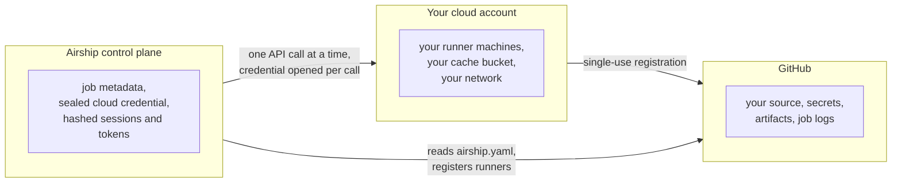

This page is written to be read adversarially. It says what the design
protects, and then — in its own section, not buried — what it does not.

## Trust boundaries

**What never crosses a boundary.** Your source code, your Actions secrets,
your artifacts and your job logs never reach the control plane — the runner
talks to GitHub directly. Your cloud credential never reaches a runner
machine. Airship holds no SSH key for your machines, and there is no inbound
network path to them.

## What Airship stores

| Data | Protection |
| --- | --- |
| Cloud credential | Verified before storage, sealed with **AES-256-GCM**, the blob **bound to its row** so it cannot be moved and opened elsewhere. Never returned by any endpoint |
| Dashboard session | Only a **SHA-256** of the cookie value. The cookie is HttpOnly, `Secure`, `SameSite=Lax` |
| Developer API token | Only a **SHA-256**, plus a display hint. Shown once at creation |
| Runner cache token | Only a SHA-256. Dead the moment the runner finishes |
| GitHub identity | ID, login, display name, avatar URL |
| Installations, repositories, runners, jobs | Metadata only: IDs, labels, states, machine shapes, timestamps, reasons |
| Activity events | What happened and why, retained 30 days |

**Never stored:** source code, artifacts, build output, Actions secrets or
variables, job logs, any cloud credential in plaintext anywhere including
logs, or cache contents — those live in your bucket, in your account.

Validation errors are shaped so they cannot echo the value that failed: the
API's error details carry a location and a message only.

## The cloud credential

The sharpest edge of the design, so it gets the most rules.

| Rule | Detail |
| --- | --- |
| **Verified before stored** | AWS with `sts:GetCallerIdentity`; Google Cloud with a Compute `projects.get`; Azure by signing in to Entra and reading the subscription, which must be visible to the application and not disabled. A key that does not work is never written |
| **Encrypted at rest** | AES-256-GCM under a key held in the control plane's environment, not in its database |
| **Bound to its row** | The sealed blob is tied to its installation and cloud. Lifting the row into another installation's record makes it undecryptable |
| **Opened per call** | Decrypted, handed to the provider for one API call, discarded. Never written to a log, an error, a metric or a response |
| **Never echoed** | No endpoint returns a secret. The dashboard shows only the public half your cloud reported at verification |
| **Rotation** | Replacing a key within the same account is always allowed |
| **Deletion is guarded** | Disconnecting a cloud, or replacing its key with one for a *different* account, is **refused while runners launched with it are alive** — without that key their machines could not be destroyed |

What the credential *can do* is your choice, and it should be the minimum.
The least-privilege policies are on [AWS](/clouds/aws#the-iam-policy),
[Google Cloud](/clouds/google-cloud#grant-roles) and
[Azure](/clouds/azure#a-narrower-role). On AWS the terminate permission can
be conditioned on Airship's own tag, so the credential **cannot destroy
anything Airship did not create**.

## Job isolation

| Property | How |
| --- | --- |
| **One job per machine** | A runner registers with a single-use configuration and exits after one job. No machine is reused, so no job can read another's checkout, on-disk caches, environment or memory |
| **The machine destroys itself** | Every exit path powers it off: the job finishing, the runner crashing, the script failing, the deadline passing. Airship then deletes it along with its disks, interface and address |
| **A deadline that does not depend on us** | The shutdown is scheduled before anything else runs. A control plane that disappears entirely leaves no machine running forever |
| **One boot, one registration** | A marker is written at first boot; a rebooted machine powers off rather than registering again |
| **No inbound access** | No ingress rules, no SSH key, no open RDP. AWS adds a security group with no ingress; Google Cloud adds no firewall rules and tags instances `airship-runner` for your own; Azure's security group carries none of Airship's rules |
| **Metadata service locked down** | On AWS, IMDSv2 is required with **hop limit 1**, so a process inside a container cannot reach instance metadata |
| **No cloud identity by default** | No instance profile, no service account, no managed identity unless a definition asks for one |
| **Encrypted disks** | AWS root volumes always; Google Cloud and Azure disks by the provider's own default |

## The GitHub registration

| Property | Detail |
| --- | --- |
| Single-use | A just-in-time configuration, consumed by one registration, good for one job |
| Scoped | To the repository — or, for organization pools, to a runner group visible only to the repositories that pool's policies allow |
| Minted before the machine | And stored first, so nothing can boot without a record to clean up |
| Removed after | Two minutes after the runner finishes, and **only if GitHub says the runner is not busy** — a busy runner means the machine exists after all, and the runner is revived rather than orphaned |
| Re-checked before launch | If the job was cancelled or started elsewhere during the round trip, no machine is created and the registration is removed at once |

## Who may spend your money

| Actor | Can | Bound by |
| --- | --- | --- |
| A GitHub org **owner** | Connect clouds, activate repositories, set `max_runners`, create API tokens | Being an owner. Roles are re-checked hourly, so removing someone revokes access within the hour |
| An org **member** | Read the dashboard | Read-only |
| Anyone who can **push to an activated repository** | Choose machine types, regions and disk sizes for that repository's jobs | `max_runners`, the machine lifetime, the attempt cap. The same authority they already have over what a workflow does |
| A **fork pull request** on a public repository | Nothing, unless that repository was activated **with public access allowed** — a separate, explicit choice | [Access policies](/organization/access-control), `max_runners`, and your judgement about what else is on those runners |
| A **developer API token** | Everything the API offers for one installation | Its installation scope. Revocable in the dashboard |
| A **live runner's cache token** | Fetch cache credentials for that installation's bucket, and nothing else | It dies when the runner finishes |

## Control plane surfaces

| Surface | Authentication | Hardening |
| --- | --- | --- |
| Dashboard API | A GitHub OAuth session cookie | HttpOnly, `Secure`, `SameSite=Lax`; an **Origin check on every write**; CORS restricted to configured origins; roles re-checked hourly |
| Developer API | A bearer token, stored hashed | **Accepts no session cookie**, so a browser cannot be tricked into calling it |
| Runner API | A runner's own token, stored hashed | Answers only for a live cache-enabled runner, and only for that installation's bucket |
| Webhook | An HMAC signature over the body | Unsigned deliveries are rejected before any work is done |

Sign-in is GitHub OAuth only. There is no password to leak and no local
account to brute-force.

## The boot script

The script runs as root. Anything interpolated into it would be remote code
execution on your machine if it could break its quoting, so nothing is
interpolated without validation: the runner version, the registration, the
control plane URL, the cache token and the Windows paths and account names all
match strict patterns, and `env_vars` travels **base64** and is decoded on the
machine, so nothing in it is ever shell or PowerShell.

Variable names starting with `GITHUB_`, `RUNNER_` or `ACTIONS_` are refused: a
config file must not be able to change how the runner talks to GitHub.

## Cache security

| Property | Detail |
| --- | --- |
| **Your key never leaves the control plane** | The machine gets a one-off token and trades it for an STS **federation token**: one hour, refreshed before expiry, narrowed by an inline policy to one bucket |
| **A hard ceiling** | A federation token can never exceed the issuing user's own permissions, so the S3 statements in your policy are the maximum anything on a runner can do |
| **Bucket ownership is proven** | Every call names the expected owner account, so a bucket of the same name in another account is refused rather than used |
| **Private by construction** | Public access blocked on every check, server-side encryption, objects expired after 7 days, incomplete uploads aborted after one |
| **A local, short-lived CA** | Generated on the machine, valid one day, trusted only there — and the machine is destroyed after one job |
| **Narrow interception** | TLS is terminated for exactly one host, and only its cache calls are answered locally. Everything else on that host is forwarded untouched; every other host is tunnelled without inspection |

## Known exposures

These follow from the model. None is a surprise, and each has a mitigation.

<AccordionGroup>
  <Accordion title="1. The single-use registration travels in instance metadata" icon="eye">
    Anyone in your cloud account who can read an instance's metadata or user
    data can read the configuration until the runner registers. The window is
    seconds, the configuration is single-use, and using it would steal one job
    rather than grant access to anything.

    [`provision_via: pull_from_api`](/configuration/environment#provisioning-from-your-image)
    avoids it entirely, at the cost of putting an API token in your image.
  </Accordion>

  <Accordion title="2. The cache bucket is one namespace per organization" icon="database">
    There is no per-branch or per-repository isolation: a pull request's job
    can write an entry a main-branch job later restores, and one repository
    can restore another's keys.

    **Keep public repositories with fork pull requests off cache runners**, or
    make their keys unguessable. Airship enforces the bucket, not the key
    space.
  </Accordion>

  <Accordion title="3. Anyone who can push to an activated repository chooses machines" icon="git-commit">
    Including an expensive one. It is the same authority they have over
    workflow content, and `max_runners` is the bound. If that is not
    acceptable for a repository, do not activate it.
  </Accordion>

  <Accordion title="4. An attached cloud identity is available to every step" icon="key">
    If a definition attaches an instance profile or service account, every
    step of every job on that runner can use it — including a fork pull
    request's code on a public repository activated for public access. Treat
    it exactly as you would a repository secret.
  </Accordion>

  <Accordion title="5. Any image your account can launch is allowed" icon="image">
    There is no image allowlist. Architecture mismatches are refused, and so
    are images a publisher has deprecated, but trustworthiness is not
    something Airship can judge.
  </Accordion>

  <Accordion title="6. Two installations can share one cloud account" icon="users">
    Isolation then rests on the installation tag: listing filters on it, and
    terminating **reads the machine first** and refuses one without the
    expected tag. It holds. A dedicated account, project or subscription per
    installation is the stronger boundary and what we recommend — on Azure in
    particular, where installations would otherwise share the resource group,
    networks and security groups.
  </Accordion>

  <Accordion title="7. Losing the credential-sealing key loses every connected cloud" icon="lock">
    By design: it is the only thing that can open the sealed credentials.
    Recovery is reconnecting each cloud. If you [run your own control
    plane](/self-hosting/configuration#credentials-key), back that key up as
    you would a root key and rotate it with the two-key procedure rather than
    by replacement.
  </Accordion>
</AccordionGroup>

## Tenancy

The tenant is the GitHub App installation — one organization or user account.

- Every database query is scoped by installation ID.
- Every machine carries the installation as a tag or label, and every list
  filters on it.
- Every teardown **reads the machine first** and refuses when the tag is not
  the installation's, so an ID recorded wrongly — or reused by the cloud for
  someone else's machine — can never destroy the wrong thing.
- Cache buckets are named from a hash of the installation ID and
  owner-checked on every call.
- API tokens are scoped to one installation; runner tokens to one runner.

## Straight answers

<ResponseField name="Where is my data?">
  Job metadata in the control plane's database. Job *content* — code, secrets,
  logs, artifacts, caches — stays in GitHub and in your cloud account, in the
  region your `airship.yaml` names.
</ResponseField>

<ResponseField name="Who can see it?">
  Whoever administers the control plane deployment, as with any hosted
  service. If that is not acceptable, [run the control plane
  yourself](/self-hosting/overview): the same code, your infrastructure, your
  sealing key.
</ResponseField>

<ResponseField name="Do you hold standing access to my cloud?">
  Yes — a credential you scope and can revoke at any time, held sealed and
  opened per call. The least-privilege policies are the floor it can operate
  on. On AWS you can condition its terminate permission so it can only ever
  destroy Airship's own machines.
</ResponseField>

<ResponseField name="Can you read my repository?">
  Only what the GitHub App's permissions allow: `airship.yaml`,
  `airship.global.yaml`, `access.yaml`, and job and runner metadata. Contents
  is a *read* permission; write and pull-request permissions are optional and
  used only by the access-control API, when you ask it to open a pull request.
</ResponseField>

<ResponseField name="What about certifications?">
  We do not claim any certification on this page. Ask us directly and we will
  tell you exactly where we are rather than point at a badge.
</ResponseField>
