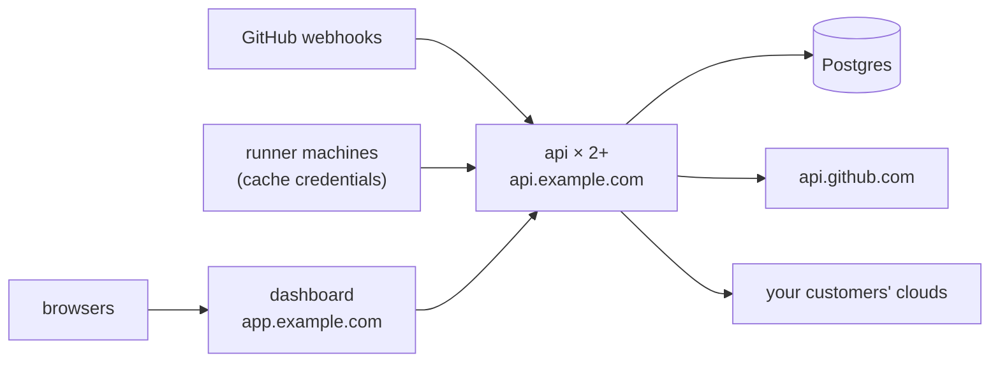

Airship's control plane is one container plus Postgres. If "whoever
administers the hosted service can see our job metadata" is not an acceptable
answer, run it yourself: the same code, your infrastructure, your sealing key.



## Two different clouds

These pages are about where **Airship itself** runs. Where **runner machines**
run is a separate choice, made by connecting a credential — see [Connecting a
cloud](/clouds/overview). The two are independent: a control plane on Cloud
Run can launch EC2 instances, and the reverse.

<Note>
  The control plane needs **no cloud permissions of its own**. It launches
  machines with the credentials you connect in the dashboard, never with the
  identity of the platform it runs on.
</Note>

## What you need

| | |
| --- | --- |
| The API container | Serves the HTTP API, receives webhooks, launches and tears down machines |
| Postgres **17 or newer** | 18 recommended. The single point of truth |
| The dashboard | A Next.js app, served as a static-ish site or a Node server |
| A GitHub App of your own | [Creating it](/self-hosting/github-app) |
| Two hostnames on one site | `app.example.com` and `api.example.com`, so the session cookie is sent |
| TLS on the API | `PUBLIC_URL` must be https — runner machines fetch the cache proxy and its credentials from it |

## The shape of a deployment

<Steps>
  <Step title="Create the GitHub App">
    Callback URL, webhook URL, permissions and event subscriptions. See
    [GitHub App](/self-hosting/github-app).
  </Step>
  <Step title="Provision Postgres and run the migration">
    The image ships a `migrate` entrypoint. Run it once per release, before
    the new API starts.

    ```bash
    docker run --rm --entrypoint migrate \
      -e DATABASE_URL=postgres://... airship-api up
    ```
  </Step>
  <Step title="Generate a credentials key and keep it safe">
    ```bash
    openssl rand -base64 32
    ```

    This key is the only thing that can open the sealed cloud credentials.
    **Losing it loses every connected cloud.** Back it up as you would a root
    key. [Configuration](/self-hosting/configuration#credentials-key)
  </Step>
  <Step title="Run the API, and the dashboard pointed at it">
    Several API replicas are fine: launchers claim runners with row locks, and
    the reconciler elects a leader through a database advisory lock.
  </Step>
  <Step title="Install your app and connect a cloud">
    From then on it is the ordinary [Quickstart](/quickstart).
  </Step>
</Steps>

## Running it

```bash
docker build -t airship-api apps/api
docker run --rm --entrypoint migrate -e DATABASE_URL=... airship-api up
docker run -p 8080:8080 \
  -e DATABASE_URL=... \
  -e PUBLIC_URL=https://api.example.com \
  -e DASH_URL=https://app.example.com \
  -e CORS_ORIGINS=https://app.example.com \
  -e CREDENTIALS_KEY=... \
  airship-api
```

API documentation is served at `/docs` on the API itself, and `/healthz`
answers for your load balancer.

<Warning>
  The image embeds the [cache proxy](/performance/caching) for `linux/amd64`
  and `linux/arm64`. A build of the API alone leaves it out, and cache-enabled
  runners then run their jobs without acceleration — recorded as
  `cache.unavailable` on **Events** rather than failing.
</Warning>

## Where to run it

<Columns cols={2}>
  <Card title="Deployment guides" icon="rocket" href="/self-hosting/deploying" arrow>
    Container platform plus managed Postgres, or a single server with Docker
    Compose and automatic TLS.
  </Card>
  <Card title="Configuration reference" icon="settings" href="/self-hosting/configuration" arrow>
    Every environment variable, what is required, and what must never be set
    in production.
  </Card>
</Columns>

## What it does not need

| | |
| --- | --- |
| Cloud permissions | None. It uses the credentials you connect |
| Inbound access to runners | None. Runners connect out |
| Persistent disk | None. State is in Postgres |
| A queue or a cache | None. Postgres only |
| Sticky sessions | No. Sessions are rows, not memory |
